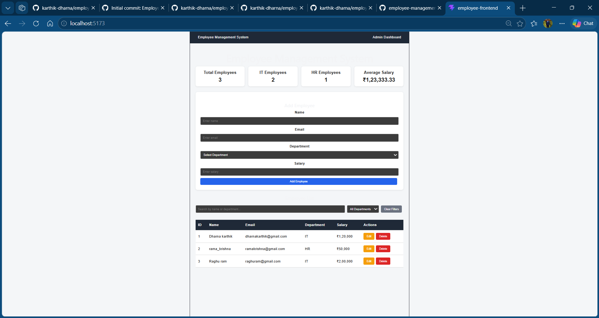

# Employee Management System

A full-stack web application for managing employee records, built using Spring Boot, React, and MySQL.

## Application Screenshot




## Overview

The Employee Management System allows users to manage employee information through a web interface. It provides REST APIs for employee operations and stores employee records in a MySQL database.

## Technologies Used

### Backend

* Java
* Spring Boot
* Spring Data JPA
* Maven
* MySQL

### Frontend

* React
* JavaScript
* HTML
* CSS
* Vite

### Tools

* IntelliJ IDEA
* MySQL Workbench
* Git and GitHub

## Features

* Add new employees
* View employee records
* Update employee details
* Delete employee records
* Search and filter employees
* Store employee data in MySQL
* Communicate with the backend through REST APIs

## Backend API

**Base URL:** `/api/v1/employees`

The backend exposes REST endpoints for managing employee records.

## Getting Started

### Prerequisites

Install the following:

* Java Development Kit (JDK)
* Maven
* MySQL Server
* Node.js and npm

### Backend Setup

1. Clone this repository.
2. Create a MySQL database named `employee_management`.
3. Configure your local database credentials using environment variables.
4. Run the Spring Boot application.

### Frontend Setup

1. Navigate to the frontend project directory.

2. Install dependencies:

   ```bash
   npm install
   ```

3. Start the development server:

   ```bash
   npm run dev
   ```

## Database Configuration

Configure your database connection locally. Do not commit database passwords or other secrets to GitHub.

## Future Improvements

* Add authentication and authorization
* Improve validation and error handling
* Deploy the application online
* Add automated tests

## Author

**Karthik**

---

This project was developed as a full-stack application to practice Java, Spring Boot, React, REST API development, and database integration.
